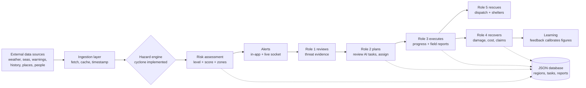
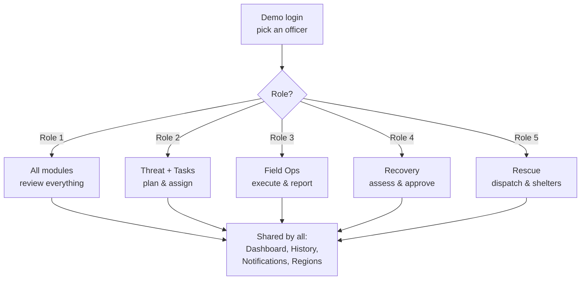
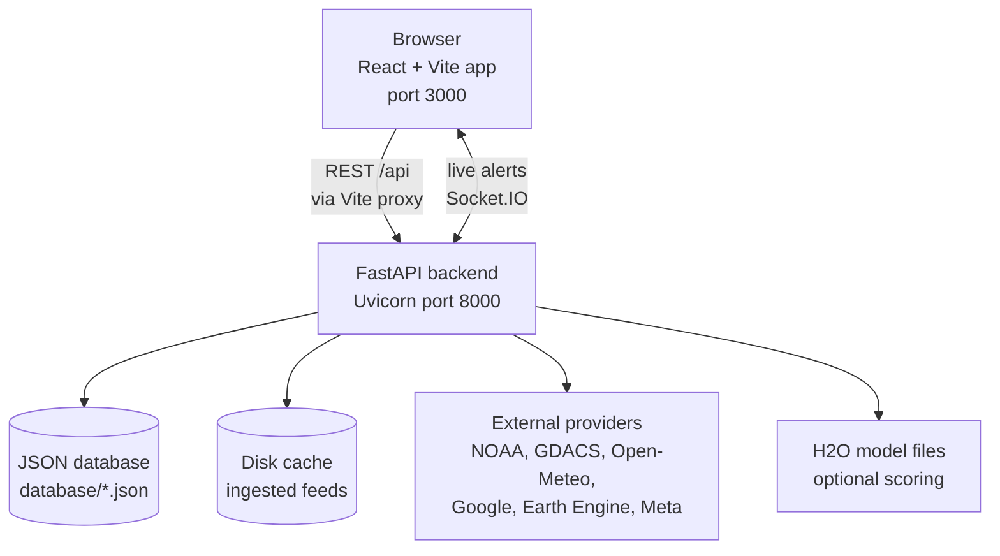
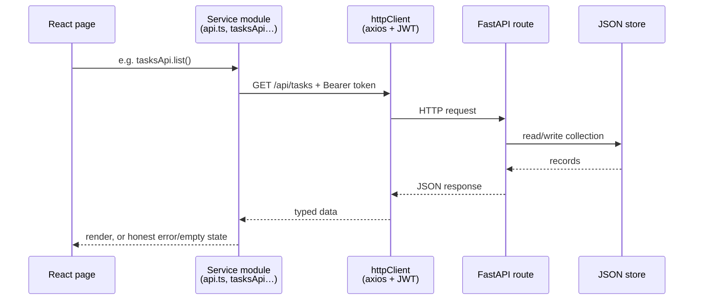
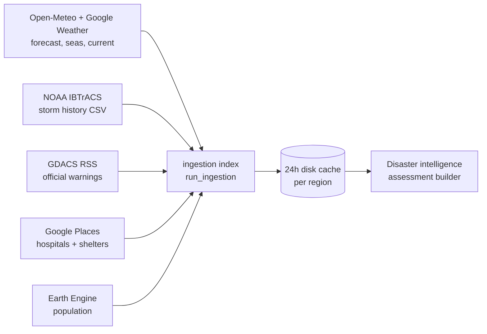
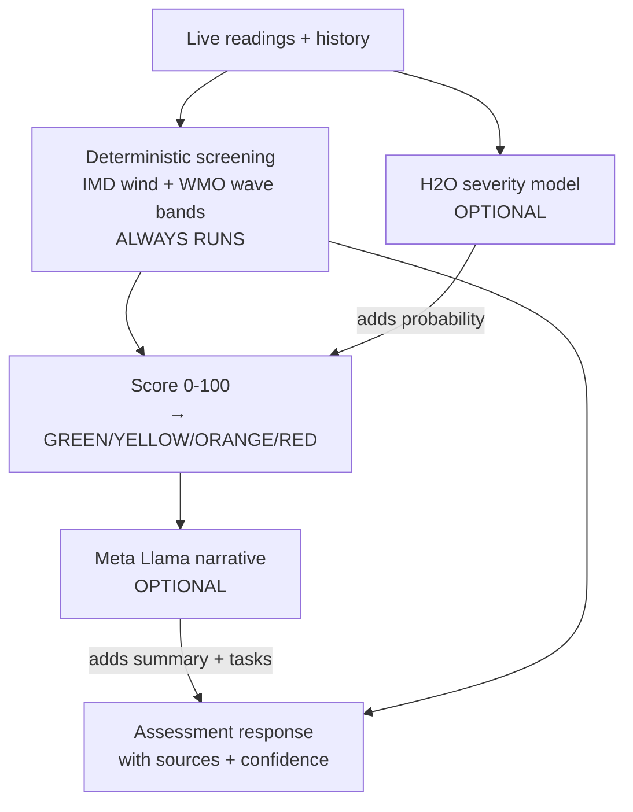
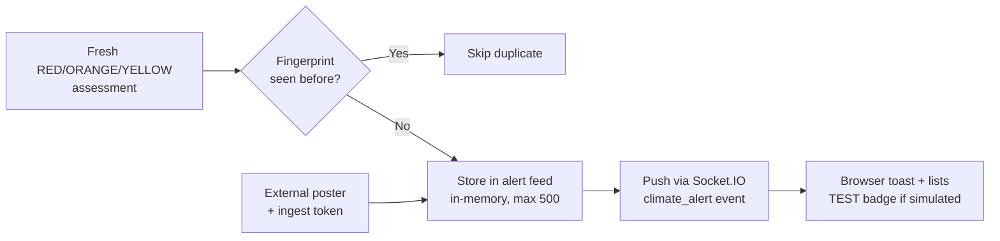
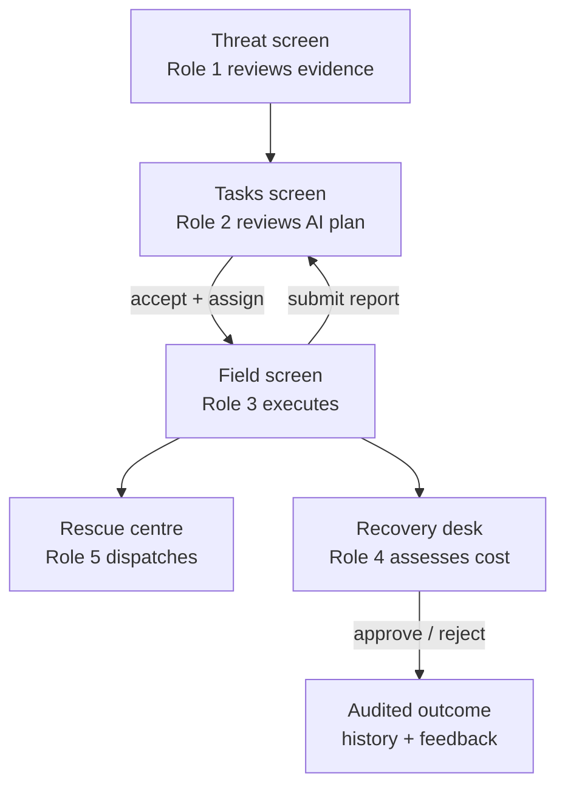
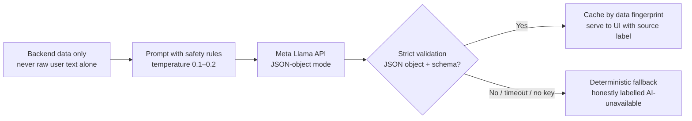

# 3P Intelligence - Predict. Prepare. Protect.

**3P Intelligence** is a platform that connects the whole disaster-management journey from early warnings to rescue to recovery — in one place, for one team, with one shared picture.

**Status labels used in this document** — so you always know what is real:

| Label | Meaning |
|---|---|
| Implemented | Working in the code, verified by inspection |
| Partial | Partly working, with known gaps |
| Planned | Described in the product vision, not built yet |
| Demo / Simulated | Training or mock content, clearly labelled in the app |

---
## Table of contents

- [Quick Start](#quick-start)
- [1. Product Overview](#1-product-overview)
- [2. How the Product Works](#2-how-the-product-works)
- [3. Application Modules](#3-application-modules)
- [4. User Roles and Permissions](#4-user-roles-and-permissions)
- [5. Technology Stack](#5-technology-stack)
- [6. System Architecture](#6-system-architecture)
- [7. Data Sources and AI Intelligence](#7-data-sources-and-ai-intelligence)
- [8. Database and API Documentation](#8-database-and-api-documentation)
- [9. Project Folder Structure](#9-project-folder-structure)
- [10. Installation and Local Setup](#10-installation-and-local-setup)
- [11. How to Use the Application](#11-how-to-use-the-application)
- [12. Simulator / Demo Mode](#12-simulator--demo-mode)
- [13. Security and Data Integrity](#13-security-and-data-integrity)
- [14. Limitations and Future Roadmap](#14-limitations-and-future-roadmap)
- [15. Glossary](#15-glossary)
- [16. Useful Developer Reference](#16-useful-developer-reference)

---

## Quick Start

Run the whole system locally (details in [Section 10](#10-installation-and-local-setup)):

#### 1) Backend (new terminal, from the project root)
##### Windows
```powershell
py -3.11 -m venv .venv
.\.venv\Scripts\Activate.ps1
python -m pip install --upgrade pip
python -m pip install -r requirements.txt
Copy-Item .env.example .env
```
##### MAC
```
python3 -m venv .venv
source .venv/bin/activate
python -m pip install --upgrade pip
python -m pip install -r requirements.txt
```
#### 2) Frontend (new terminal, from the project root)
```powershell
cd Frontend
npm install
npm run dev              # serves http://localhost:3000
```

Then open **http://localhost:3000**, pick a demo officer (for example **Aarav Sharma**, the assessment officer) and press **Sign In**. No password is needed for the demo login. Try the **Simulator** button in the header for a guided training drill without touching live data.

---

## 1. Product Overview

### What is 3P Intelligence?

3P Intelligence — Predict. Prepare. Protect. helps authorities prepare for disasters before they happen. By turning early warnings, real-time data and risk percentage into actionable insights, it helps authorities anticipate risks, make informed decisions, mobilise resources, coordinate response, and protect lives. 
### What problem does it solve?

Today, disaster response is scattered: weather data lives in one place, warnings in another, task lists in spreadsheets, field updates in chat groups, and damage figures in paper files. That fragmentation causes slow decisions, duplicated work, and missed warnings. 3P Intelligence puts **monitoring, verification, planning, execution, rescue, and recovery** into one auditable workflow so every role sees the same situation and the handoffs between roles are explicit.

### Why is it needed?

- Disasters are becoming more frequent and more damaging; response windows keep shrinking.
- Officers need **evidence with sources and timestamps**, not black-box claims — the platform shows where every number came from.
- AI can help draft plans and explanations, but consequential calls (approve, evacuate, compensate) must stay with **authorized humans**. The system is built around that principle.

### Vision, mission and key objectives

- **Vision:** a global, evidence-driven, human-supervised disaster intelligence and response platform.
- **Mission:** connect early warning, verification, preparedness, field execution, impact estimation, and rescue support in one trustworthy workflow.
- **Key objectives (from the system overview):**
  1. Detect potential hazards early from reliable sources.
  2. Explain risk with evidence, assumptions, and honest uncertainty.
  3. Notify the right officers with retries and fallbacks.
  4. Keep humans in charge of approvals, assignments, and payouts.
  5. Track every decision, task change, and notification for audit.
  6. Learn from outcomes without ever auto-deploying unvalidated models.

### Who uses it and who benefits?

| User                                  | Benefit                                                                                       |
| ------------------------------------- | --------------------------------------------------------------------------------------------- |
| Disaster Assessment Officer (Role 1)  | AI detects hazards and highlights risks. The officer reviews and approves alerts.             |
| Operations Planner (Role 2)           | AI suggests response plans and tasks. The planner reviews, edits, and assigns them.           |
| Field Operations Officer (Role 3)     | AI helps prioritise tasks. Officers update progress and submit photo evidence.                |
| Insurance & Recovery Officer (Role 4) | AI estimates damage and compensation. The officer reviews and approves the assessment.        |
| Rescue & Relief Officer (Role 5)      | AI suggests shelters, routes, and resources. The officer reviews and confirms rescue actions. |

AI recommends. Humans review, edit (if needed) and approve.
### What makes it different?

1. **Evidence first** — every assessment carries sources, timestamps, assumptions, and confidence; missing data is reported as missing, never invented.
2. **Honest AI, powered by Meta** — Meta Llama drafts the words, but the system labels what is observed, what is a model estimate, what is an AI suggestion, and what a human confirmed — and humans always make the final call.
3. **Full lifecycle** — most tools cover either warnings *or* tasks *or* claims; this one connects all three with role handoffs.
4. **Safe by design** — demo/simulated content is fenced off from live data, and the app never claims to have sent real emergency messages it did not send.

## 2. How the Product Works

Here is the complete journey, in the order things happen. (Status labels: ✅ = working, 🟡 = partial, 🔮 = planned.)

### The journey in nine steps

1. **Data collection and ingestion** ✅ — The backend regularly pulls weather forecasts, sea conditions, historical storm tracks, official warnings, hospitals/shelters, population, and geography from public and commercial providers (see [Section 7](#7-data-sources-and-ai-intelligence)). Results are cached locally so the app stays fast and honest about freshness.
2. **Hazard detection and intelligence** ✅ — For the selected region and hazard, the intelligence engine combines live readings with historical analogues and produces one assessment: a level (GREEN / YELLOW / ORANGE / RED), a 0–100 score, and the reasons behind it. Today the only fully implemented hazard engine is **cyclone**; other hazards return an explicit "not implemented" status instead of a fake answer.
3. **Alerts and notifications** ✅ — When a fresh assessment crosses a threshold, the backend creates an alert, avoids duplicates with fingerprints, stores it, and pushes it live to browsers over WebSockets. Officers also get an in-app notification inbox for assignments and field updates. External alert ingestion is available through a token-protected endpoint.
4. **AI recommendations and decision support** ✅🟡 — A deterministic screening layer (published IMD/WMO thresholds) always runs; an H2O machine-learning model adds a severity probability when its model file is installed; and Meta Llama drafts plain-language summaries, recommended tasks, and dispatch answers when its API key is configured. If any AI piece is missing, the app says so and falls back to deterministic output.
5. **Government officer planning and task assignment** ✅ — The Operations Planner reviews AI-suggested tasks (accept, edit, or reject with reasons), creates manual tasks, assigns them to field officers with priority/department/deadline, and dispatches in-app alerts. Everything is confirmed by the backend or kept as a clearly-marked local record.
6. **Field team operations** ✅ — Field officers see their queue, filter and search it, start work, move a progress bar, and submit situation reports (observations, people assisted, location, up to 5 photos). Reports flow back to the planner's inbox.
7. **Rescue and relief coordination** ✅ — A command centre shows the situation overview, rescue dispatch, shelter/relief status, route intelligence, and an Meta AI tactical assistant that answers location-aware questions using live facility data. (Route "verification" reflects available data feeds, not ground truth sensors.)
8. **Damage assessment, recovery and compensation** ✅ — Officers record obsearved damage counts and spending; a deterministic engine turns them into costed figures where **every number carries its calculation, assumptions, sources, and confidence**. Officers can edit figures with reasons, approve or reject assessments, download report files, and submit corrections that feed calibration. The built-in rates are planning defaults, not official SDRF/NDRF schedules.
9. **Historical disaster information** ✅ — Past cyclone tracks near the selected region (NOAA IBTrACS, North Indian Ocean) with search, filters, sorting, and pagination — used both for learning and as analogues inside live assessments.

### End-to-end workflow diagram



*In plain words: data flows in from the left, becomes a risk assessment, becomes alerts, then walks down the chain of human roles — verify, plan, execute, rescue, recover — while everything important is stored for audit and learning.*

## 3. Application Modules

Every module below is a real page in the app. Each entry says who it is for, what you can do, where its data comes from, and whether the intelligence is real data, AI-generated, estimated, or simulated.

### 3.1 Dashboard (Overview) ✅

- **Purpose:** the landing page — a one-glance situation board for the selected region.
- **Who uses it:** every signed-in role.
- **What users can do:** see population, forecast, nearby facilities, and local impact cards; explore the interactive map (risk zones, shelters, hospitals, alerts); read the 7-day weather/hazard chart; check backend data-source health and recent climate alerts.
- **Connects with:** Threat (same intelligence), Notifications (alert centre), Tasks (planning).
- **Data displayed:** live ingested telemetry + intelligence for the selected region.
- **Nature:** real data with honest unavailable states; AI summary text when Meta is configured.

### 3.2 Disaster Assessment (Threat Detection) ✅

- **Purpose:** Role 1's evidence desk for verifying threats.
- **Who uses it:** Disaster Assessment Officers (Role 1) and Operations Planners (Role 2).
- **What users can do:** pick a hazard; read local-impact verdict, wind/surge readings, screening score, H2O severity probability, official GDACS warnings with source links, footprint geometry, risk-zone map, assessment factors, and AI analysis.
- **Connects with:** Dashboard (shared intelligence), Tasks (Role 2 turns assessments into assignments).
- **Data displayed:** deterministic screening + ML probability + official warnings + AI narrative.
- **Nature:** real screening; ML/AI layers clearly labelled and optional. **Note:** threat review is currently read-only — the approve/reject/request-info decision action from the product vision is 🔮 planned, not built.

### 3.3 Notifications (Alerts) ✅

- **Purpose:** two inboxes in one place — operational task notifications and live climate alerts.
- **Who uses it:** every role.
- **What users can do:** read and mark task notifications as read; refresh; browse the live climate-alert feed with connection status and retry.
- **Connects with:** Tasks (assignments create notifications), Field (reports notify the planner), backend alert service (socket feed).
- **Data displayed:** backend notification records + live/ingested climate alerts.
- **Nature:** real records. A WhatsApp channel card is shown as 🔮 Upcoming (no code behind it), and stale `whatsapp_*.json` files exist in the database with no active code.

### 3.4 Response Planning & Tasks ✅

- **Purpose:** Role 2's workbench — turn AI suggestions into assigned field work.
- **Who uses it:** Operations Planners (Role 2); others get read-only access with an explanatory banner.
- **What users can do:** review AI-recommended tasks (accept/edit/reject with reasons), create manual emergency tasks, assign to Role 3 officers with department/priority/deadline/instructions, dispatch in-app alerts, track assignments, and read field completion notices.
- **Connects with:** Threat (recommendations source), Field (assignments flow down), Notifications (dispatches flow out), Recovery (completed work becomes evidence).
- **Data displayed:** AI recommendations + backend task/notification records + officer directory.
- **Nature:** AI suggestions are explicitly suggestions until a human accepts; writes are backend-confirmed or kept as labelled local records. A 48-hour countdown appears for red-zone responses.

### 3.5 Field Operations & Reporting ✅

- **Purpose:** Role 3's task queue and reporting tool.
- **Who uses it:** Field Operations Officers (Role 3).
- **What users can do:** see stat cards (assigned/in-progress/submitted/urgent), search and filter tasks, open task details with progress bars, start work (50%) and mark submitted (100%), and file situation reports (observations, people assisted, location, up to 5 photos ≤ 5 MB each).
- **Connects with:** Tasks (receives assignments), Notifications (reports notify Role 2), Recovery (reports become assessment evidence).
- **Data displayed:** backend task records and submitted field reports.
- **Nature:** real operational records; photo evidence stored as data attachments.

### 3.6 Rescue & Relief Operations ✅

- **Purpose:** Role 5's emergency command centre.
- **Who uses it:** Rescue Relief Officers (Role 5).
- **What users can do:** monitor the situation overview, run rescue dispatch (create/update/reassign tasks), track shelters and relief, consult route intelligence, review the activity log, and chat with the AI tactical assistant for location-aware guidance.
- **Connects with:** Tasks/Field (same task records), Threat (risk context), facilities data (shelters/hospitals).
- **Data displayed:** live tasks, notifications, facilities, and AI answers.
- **Nature:** real records + AI-generated guidance grounded in live facility data. Safety wording reminds users it never invents shelters/routes and does not replace official emergency command.

### 3.7 Recovery & Compensation ✅

- **Purpose:** Role 4's damage, cost, and compensation desk.
- **Who uses it:** Insurance Recovery Officers (Role 4); Role 1 has read access for oversight.
- **What users can do:** record observed damage counts and preparedness/recovery spending; generate deterministic costed assessments; edit any figure with a reason; approve or reject assessments; download report files; attach photo evidence; submit corrections that calibrate future figures; review calibration analysis.
- **Connects with:** Field (reports/evidence feed the engine), Tasks (submitted work counts as evidence), Region Management (region/hazard catalogues).
- **Data displayed:** deterministic figures with calculation + assumptions + sources + confidence each.
- **Nature:** estimated by transparent formulas (planning-default rates, **not** official SDRF/NDRF schedules); optional Meta-drafted narrative; nothing here is an official approval or payment.

### 3.8 Disaster History ✅

- **Purpose:** learn from the past — past cyclone tracks near any region.
- **Who uses it:** every role.
- **What users can do:** search, filter by hazard, sort (newest/oldest/wind/distance), and page through historical events with peak winds, surge, and closest approach.
- **Connects with:** Threat (history provides analogues inside live assessments).
- **Data displayed:** NOAA IBTrACS North Indian Ocean cyclone tracks.
- **Nature:** real historical records. Coverage is cyclones-only and explicitly marked incomplete.

### 3.9 Region Management ✅

- **Purpose:** configure the operational world — regions, hazards, and the default dashboard region.
- **Who uses it:** every role can open it (it is appended to all role menus).
- **What users can do:** create/edit/deactivate regions with country → state → city geography, hazard assignments, and codes; manage the default region; get automatic validation of region codes and geography consistency; sync global geography data.
- **Connects with:** everything — the default region drives the Dashboard, Threat, Tasks, and Recovery region scopes.
- **Data displayed:** backend region/hazard/country/state/city records.
- **Nature:** real configuration records. Country/state/city options come from a synced open dataset (153k cities).

### 3.10 Baseline / Digital Twin 🟡

- **Purpose:** an early "digital twin" walkthrough (map layers, facilities, phased onboarding).
- **Who uses it:** reachable at `/baseline` for permitted roles, but **not linked in the sidebar** — effectively a legacy/experimental screen.
- **What users can do:** toggle map layers and step through a scripted baseline tour.
- **Nature:** mostly static/experimental content; superseded by the Dashboard and Threat modules.

### 3.11 Disaster Simulation (guided demo) 🧪

- **Purpose:** a one-screen narrated miniature of the whole platform for training and demos.
- **Who uses it:** anyone (Demo & Training sidebar section, separated from operational modules).
- **What users can do:** pick a Red/Orange/Green cyclone zone drill, watch a simulated alert toast, then follow Role 1 → 2 → 3 → 4 → 5 handoffs down a timeline with a mock map, tasks, estimates, and outcome.
- **Data displayed:** hardcoded fictional data only.
- **Nature:** 100% simulated; makes no backend calls, writes nothing, notifies nobody.

### 3.12 Simulator Mode (app-wide drill) 🧪

- **Purpose:** flip the *entire real application* into a training drill: same pages, same workflows, fictional data.
- **Who uses it:** anyone, via the Simulator button in the header.
- **What users can do:** pick a cyclone Red/Orange/Green zone, work through all modules with coherent drill data (alerts, tasks, reports, recovery figures), then exit back to live data at any time.
- **Nature:** fully simulated in-memory snapshot isolated from live records; see [Section 12](#12-simulator--demo-mode).

## 4. User Roles and Permissions

There are five roles, stored in `database/roles.json` with demo users `user_1`–`user_5` in `database/users.json`. Your role decides which sidebar modules you see (frontend) and which operations the backend allows (JWT + role checks).

### The five roles

| Role | Title | Responsibility | Demo user |
|---|---|---|---|
| `role_1` | Disaster Assessment Officer | Reviews threat evidence and risk levels | Aarav Sharma |
| `role_2` | Operations Planner | Reviews AI plans, assigns and tracks tasks | Priya Verma |
| `role_3` | Field Operations Officer | Executes tasks, files field reports | Rahul Singh |
| `role_4` | Insurance Recovery Officer | Damage, cost, and compensation assessments | Ananya Patel |
| `role_5` | Rescue Relief Officer | Rescue dispatch, shelters, and routes | Vikram Joshi |

### Module access by role (from actual code)

✅ = visible/accessible. Everyone sees Dashboard, History, Notifications, and Region Management.

| Module | Role 1 | Role 2 | Role 3 | Role 4 | Role 5 |
|---|---|---|---|---|---|
| Dashboard (Overview) | ✅ | ✅ | ✅ | ✅ | ✅ |
| Historical Disasters | ✅ | ✅ | ✅ | ✅ | ✅ |
| Notifications | ✅ | ✅ | ✅ | ✅ | ✅ |
| Region Management | ✅ | ✅ | ✅ | ✅ | ✅ |
| Disaster Simulation (demo) | ✅ | ✅ | ✅ | ✅ | ✅ |
| Disaster Assessment (Threat) | ✅ | ✅ | – | – | – |
| Response Planning & Tasks | ✅ | ✅ | – | – | – |
| Field Operations | ✅ | – | ✅ | – | – |
| Rescue & Relief | ✅ | – | – | – | ✅ |
| Recovery & Compensation | ✅ | – | – | ✅ | – |

Role 1 is effectively the super-reviewer: it can open every module. Backend enforcement mirrors this: task/notification/assessment writes require a valid JWT, assessment writes are Role 4 only (reads shared with Role 1), and the Tasks UI additionally gates editing to Role 2 with a read-only banner for others.



---

## 5. Technology Stack

Every item below was verified in `package.json`, `requirements.txt`, config files, or imports. Simple explanations included for non-technical readers.

### Frontend (the part you see and click)

| Technology | Version* | What it is, simply | Why it is used |
|---|---|---|---|
| React | 19 | A popular JavaScript library for building interactive screens | Builds every page and component |
| TypeScript | 7 | JavaScript with type-checking (catches mistakes early) | Safer, self-documenting code |
| Vite | 8 | A very fast development server and build tool | Instant reloads; builds the production bundle |
| Tailwind CSS | 4 | Styling via small utility classes | The government-portal look, responsive design |
| React Router | 7 | Page navigation without full reloads | Routes like `/overview`, `/tasks`, `/recovery` |
| Axios | 1.x | A helper for calling backend APIs | All data fetching, with auth tokens attached |
| Leaflet + React-Leaflet | 1.9 / 5 | Open-source interactive maps | Risk-zone circles, shelters, hospitals, alerts |
| OpenStreetMap tiles | – | Free community map images | The base map under all markers |
| Socket.IO client | 4.x | Live two-way messaging over WebSockets | Instant alert pop-ups without refreshing |
| Lucide icons | – | A clean open-source icon set | All UI icons |

\*Versions from `Frontend/package.json` at time of writing.

### Backend (the engine room)

| Technology | What it is, simply | Why it is used |
|---|---|---|
| Python + FastAPI | A modern, fast Python web framework | Serves all REST APIs with automatic docs |
| Uvicorn | The server that runs the Python app | Production/development web server (`Procfile` + `server.py`) |
| python-socketio | Live push messaging for Python | Broadcasts new alerts to all open browsers |
| PyJWT | Signed login tokens | Session tokens after demo login |
| Requests | Simple HTTP calls from Python | Fetching weather, warnings, and history feeds |
| python-dotenv | Loads settings from a `.env` file | Keeps keys and secrets out of code |
| ReportLab | PDF generation in Python | Downloadable assessment reports |
| H2O AutoML | Automatic machine-learning training | Pre-trained severity-probability model (see §7) |
| earthengine-api | Google Earth Engine access | Population estimates per region |

### Database and storage

| Technology | What it is, simply | Why it is used |
|---|---|---|
| JSON files (`database/`) | Human-readable text files, one per collection | Zero-setup local database; atomic writes + process lock in `json_store.py` |
| Local disk cache (`Backend/data/ingested`) | Saved API responses with expiry times | Fast pages + honest freshness without re-downloading |
| Browser localStorage | Small website-side storage | Draft task reviews per region |
| Browser sessionStorage | Temporary tab-side storage | The login token (cleared when the tab closes) |

### AI, maps, auth, and hosting

| Area | Technology | Status |
|---|---|---|
| Text reasoning/explanations | Meta Llama | ✅ Optional; strict JSON validation + deterministic fallback |
| Severity probability | H2O AutoML gradient-boosting model on IBTrACS tracks | ✅ Optional; needs `H2O_MODEL_PATH`, else reports unavailable |
| Deterministic assessment | Transparent formula engine (`assessment_engine.py` v1.1) | ✅ Always on; every figure shows calculation + confidence |
| External data | NOAA IBTrACS, GDACS, Open-Meteo, Google Weather/Places, Earth Engine, dr5hn geo dataset | ✅ See §7 |
| Login | Demo officer picker → JWT (HS256, 60 min) | ✅ No passwords (demo-grade) |
| Realtime | Socket.IO `climate_alert` events | ✅ Implemented |


## 6. System Architecture

### 6.1 Overall system architecture



*In plain words: your browser talks to one Python backend. The backend reads/writes small JSON database files, keeps a cache of downloaded feeds, calls outside data and AI providers, and pushes live alerts back to every open browser.*

### 6.2 Frontend-to-backend communication



*In plain words: pages never call the network directly — they ask a service module, which attaches your login token, and every failure becomes a readable message or empty state instead of a crash. In Simulator Mode the service layer answers from an in-memory drill snapshot instead (§12).*

### 6.3 Data ingestion and processing



*In plain words: independent fetchers pull each feed, results are cached per region with expiry times, and the intelligence builder combines them into one assessment. A cold cache can take minutes on first load (the storm-history file is large), so API timeouts are generous and every response reports its own freshness.*

### 6.4 AI/ML intelligence pipeline



*In plain words: published-threshold screening always produces the score; the ML model and the chat AI only add optional layers. If either is unconfigured or fails, the response says so and the deterministic result still stands.*

### 6.5 Alert and notification workflow



*In plain words: significant assessments become alerts once (duplicates are fingerprinted away), live in a capped in-memory feed, and pop up instantly in every browser. Task notifications (assignments, reports) are separate persistent inbox records, not socket events.*

### 6.6 Role-based operational workflow



*In plain words: evidence becomes a plan, the plan becomes assigned tasks, tasks become field reports, and reports become both rescue actions and audited cost figures. Each arrow is a human handoff.*

---

## 7. Data Sources and AI Intelligence

### External data sources

| Source | Provides | Used for | Needs |
|---|---|---|---|
| Open-Meteo (forecast + marine APIs) | 7-day forecast, wave/sea data | Dashboard charts, threat readings | Nothing (free, no key) |
| Google Weather API | Current conditions + forecast lookup | Precise local readings | `GOOGLE_MAPS_API_KEY` |
| Google Places API | Nearby hospitals and shelters with coordinates | Maps, rescue, dispatch context | `GOOGLE_MAPS_API_KEY` |
| NOAA IBTrACS CSV (North Indian) | Historical cyclone tracks | History module, analogues, ML training | Nothing (slow first download, cached) |
| GDACS RSS (EC-JRC, CC BY 4.0) | Official disaster warnings | Warning floor + source links | Nothing |
| Google Earth Engine | Population estimates | Region cards, exposure context | `GEE_PROJECT_ID` (optional; graceful warning if missing) |
| dr5hn countries-states-cities (GitHub, ODbL) | 250 countries, ~5.3k states, ~153k cities | Region Management geography | Run `sync_geo_data.py` |
| Meta Llama API (OpenAI-compatible) | Text reasoning, summaries, task drafts, dispatch answers | AI layers across modules | `META_API_URL`, `META_API_KEY`, `META_MODEL` |

### How data is processed and stored

1. Fetchers download each feed and stamp it with a timestamp.
2. Responses are cached as JSON under `Backend/data/ingested` with TTLs (e.g. population 24 h).
3. The intelligence builder merges feeds into one assessment object carrying `data_quality` (status per source, errors, timestamps).
4. Operational records (tasks, reports, assessments) live in `database/*.json`, written atomically.

### Supported hazards and models

- **Hazard engines:** cyclone is the only implemented engine (`services/hazard_intelligence.py`). Regions may configure other hazard IDs, but intelligence calls for them return `not_implemented`; unconfigured ones return `not_configured` — never fabricated.
- **History coverage:** cyclones only; responses explicitly report `history_coverage.complete: false`.
- **ML model:** H2O AutoML gradient-boosting classifier (`GBM_1_AutoML_1_20261028_194326`, AUC ≈ 0.997 on validation) predicting *P(same-storm max wind ≥ 118 km/h within the next 24 h)* from latitude, longitude, month, wind, and pressure. Enable with `H2O_MODEL_PATH`; retrain/audit with `Backend/scripts/train_risk_model.py` on real IBTrACS rows (`models/ibtracs_training.csv`, `model_card.json`).
- **Reasoning model:** Meta Llama (model id from your own console) behind a strict client: replies must be valid JSON objects or the call fails over to deterministic text. Used for assessment narratives, recommended tasks, and rescue dispatch answers.

### Spotlight: Meta Llama, the reasoning engine of this project

This project was built for the Meta hackathon around one idea: **Meta Llama does the reasoning and writing; deterministic code and humans do the deciding.** Every AI-generated sentence in the app comes from a Meta Llama model (your own model id, via an OpenAI-compatible `/chat/completions` endpoint). Nothing is hard-coded to look smart — and when Meta is unreachable, the app says so instead of faking it.

**The 4 places Meta reasons in the code:**

| # | What Meta writes | Where you see it | How it is wired (files) |
|---|---|---|---|
| 1 | Threat briefing: `summary` + `recommended_tasks[]` + `reasoning_context[]` | Threat module's AI analysis panel; the same tasks land in the Role 2 review queue | `ingestion_layer/disaster_intelligence.py` builds an `ai_context` from backend data only → `services/ai_client.py` → `services/meta_client.py` (`temperature=0.1`, JSON-object mode) |
| 2 | Rescue answers: guidance `text` + structured `verifiedRoute` | Rescue command centre's tactical assistant chat | `services/dispatch_service.py` ("3P Verified Dispatch" prompt with live hospital/shelter JSON, `temperature=0.2`) |
| 3 | Recovery narrative: a short plain-language damage summary | Each assessment's narrative, stamped with a `narrativeSource` label | `services/assessment_engine.py` (~line 940: "Use ONLY the supplied numbers…", `temperature=0.1`, minimum-length check) |
| 4 | The shared client itself | (Plumbing) | `services/meta_client.py`: reads `META_API_URL`/`META_API_KEY`/`META_MODEL` from the environment, posts `{model, messages, temperature, response_format: {type: "json_object"}}`, and accepts the reply **only if it parses as a strict JSON object** — anything else raises `MetaClientError` |

**How one Meta call flows (same pattern everywhere):**



**Guardrails baked into the prompts (anti-hallucination by design):** the threat prompt carries 11 hard rules — never invent weather observations, surge measurements, historical disasters, population numbers, shelters, hospitals, payouts, or coordinates; never change the backend's risk level; say explicitly when data is unavailable; never claim an evacuation order; recommend only practical actions backed by evidence. The dispatch prompt forces exact facility names from the supplied data ("Do not invent names"). The recovery prompt forbids inventing measurements, payouts, approvals, or eligibility.

**Why this matters (for judges and stakeholders):**

- **Grounded, not generative-roulette:** Llama only ever reasons from backend-supplied JSON; generation temperature is 0.1–0.2 and replies are schema-validated before use.
- **Labelled provenance:** AI text arrives stamped (e.g. `meta-llama:{model}`) while fallback text is stamped `deterministic-template` — the UI always shows which one you are reading.
- **Humans stay in charge:** Llama drafts, officers accept/edit/reject; approvals, assignments, and payouts are human actions recorded with reasons.
- **Cheap and resilient:** threat insights are cached per data fingerprint (identical data = zero new calls, logged as `ai=cache`), and every failure path degrades to an honest "AI unavailable" message with the deterministic result intact.
- **One switch:** set the three `META_*` variables to enable everything; unset them and the full product still runs deterministically.

### The four kinds of "intelligence" — do not confuse them

| Kind | Example | Trust level |
|---|---|---|
| 🟢 Official warning | GDACS episode with source link and validity dates | Authoritative; can only *raise* the risk floor, never be lowered by screening |
| 🟡 ML prediction | H2O severity probability with model id | Screening signal with known metrics; unavailable unless the model file is installed |
| 🔵 AI recommendation | Llama-drafted tasks, summaries, dispatch answers | Suggestions until a human accepts; validated JSON, shown with reasoning context |
| ⚪ Deterministic assessment | IMD/WMO-threshold score 0–100 with factors | Always-on transparent screening; citable bands (RED ≥ 75, ORANGE ≥ 50, YELLOW ≥ 25) |

### Fallbacks and limitations

- Missing provider → the field reports `Unavailable` with the reason; the page still renders everything else.
- Missing Meta key → deterministic text; missing H2O file → probability honestly `UNAVAILABLE`.
- IBTrACS has weeks-scale latency: it corroborates history, never real-time warnings.
- Official warnings apply only to current episodes inside a 3-day recency window.
- Unknown regions → 404; unknown hazards → 422; missing evidence → 503 rather than a reassuring low score.

## 8. Database and API Documentation

### Database structure

The database is a folder of JSON files (`database/`). Each file holds one **collection**: an object mapping document id → fields. The backend injects `id` on read and writes atomically (temp file + rename) with a process-wide lock (`Backend/services/json_store.py`). Point the backend at a different folder with `DATABASE_DIR` (tests use this for isolation).

| File | Collection | What is stored |
|---|---|---|
| `roles.json` | roles | 5 role definitions (`role_1`–`role_5`), seeded |
| `users.json` | users | 5 demo officers (`user_1`–`user_5`), seeded |
| `regions.json` | regions | Operational regions created in the app |
| `hazards.json` | hazards | Hazard types (seeded, e.g. cyclone) |
| `countries.json` / `states.json` / `cities.json` | geo | Global geography from the sync script (`cities.json` is huge and gitignored) |
| `settings.json` | settings | `regionManagement` + `geoSync` records (incl. default region) |
| `tasks.json` | tasks | Assignments from Role 2 to Role 3, with status/progress/reports |
| `notifications.json` | notifications | Inbox messages for assignments and updates |
| `assessments.json` | assessments | Recovery assessments with figures, edits, decisions, reports |
| `assessment_feedback.json` | assessment_feedback | Officer corrections used for calibration |
| `damage_assessments.json` | damage_assessments | Observed damage counts per region + hazard |
| `expenses.json` | expenses | Preparedness/recovery spending with receipts |
| `evidence_attachments.json` | evidence_attachments | Photo evidence linked to damage/task/assessment/expense records |
| `assessment_reports/` | report files | Generated assessment report downloads |
| `whatsapp_*.json` | – | ⚠️ Stale files; no active code reads or writes them |

**Important relationships:** users → roles (each user has one `roleId`); tasks → users (assignee) + regions; notifications → tasks (optional link) + users; field reports live inside tasks; assessments reference regions/hazards and aggregate damage + expense + task evidence; evidence attachments link to any of damage/task/assessment/expense.

### API endpoints by module

Base URL in development: `http://localhost:8000` (the frontend calls `/api/...` through its dev proxy). Auth column: 🔒 = JWT Bearer required, 🔑 = special token header, 🌐 = public.

**System & telemetry** (all 🌐)

| Method | Endpoint | Purpose |
|---|---|---|
| GET | `/api/health` | Liveness check |
| GET | `/api/region` | Region bounding boxes for the map |
| GET | `/api/population?region=` | Population estimate |
| GET | `/api/forecast?region=` | 7-day forecast |
| GET | `/api/current-conditions?region=` | Current weather readings |
| GET | `/api/shelter?region=` | Hospitals + shelters with coordinates |
| GET | `/api/history?...` | Historical events (page, search, sort, hazard filter) |

**Disaster intelligence** (🌐)

| Method | Endpoint | Purpose |
|---|---|---|
| GET | `/api/disaster-intelligence/{region}?hazard=` | Full assessment (level, score, zones, warnings, AI analysis) |
| GET | `/api/disaster-intelligence/{region}/capabilities` | Which hazards are configured/implemented |
| POST | `/api/dispatch-chat` | AI tactical assistant answer for rescue (`{query, region}`) |

**Alerts** (GET 🌐; POSTs 🔑)

| Method | Endpoint | Purpose |
|---|---|---|
| GET | `/api/alerts?limit=` | Live alert feed (simulations filtered out) |
| POST | `/api/alerts` | External alert ingestion (`X-Alert-Ingest-Token: ALERT_INGEST_TOKEN`) |
| POST | `/api/simulator/alerts` | Drill broadcast (`X-Simulator-Token: SIMULATOR_BROADCAST_TOKEN`) |

**Auth, roles, users**

| Method | Endpoint | Purpose |
|---|---|---|
| POST | `/api/auth/login` | Demo login with `{user_id}` → JWT + user profile (🌐) |
| GET | `/api/auth/me` | Verify session, returns current user (🔒) |
| GET | `/api/roles`, `/api/roles/{id}`, `/api/users`, `/api/users/{id}` | Directory reads (🌐) |

**Regions & geography** (🌐 — see Security §13 for the caveat)

| Method | Endpoint | Purpose |
|---|---|---|
| GET/POST | `/api/regions`, `/api/regions/{id}` (GET/PUT/DELETE) | Region CRUD with validation |
| GET/POST/PUT/DELETE | `/api/region-configuration` | Default-region setting |
| GET | `/api/hazard-types` | Hazard catalogue |
| GET | `/api/countries`, `/api/states`, `/api/cities`, `/api/geo/status` | Global geography + sync status |

**Tasks & notifications** (🔒)

| Method | Endpoint | Purpose |
|---|---|---|
| GET/POST | `/api/tasks` | List (filterable) / create assignments |
| GET/PATCH | `/api/tasks/{id}` | Read / update status, progress, reports, reassignment |
| GET/POST | `/api/notifications` | Inbox (`?box=mine\|inbox\|sent`) / dispatch a message |
| PATCH | `/api/notifications/{id}/read` | Mark read |

**Recovery** (🔒; writes Role 4 only, reads shared with Role 1)

| Method | Endpoint | Purpose |
|---|---|---|
| GET/POST | `/api/assessments` | List / generate a costed assessment |
| GET/PATCH | `/api/assessments/{id}` | Read / apply official figure edits |
| POST | `/api/assessments/{id}/decision` | Accept or reject with a reason |
| GET/POST | `/api/assessments/{id}/reports[/regenerate]` | Report versions |
| GET | `/api/assessments/{id}/report.pdf` | Download the report file |
| GET | `/api/assessment-feedback`, `.../analysis` | Corrections + calibration analysis |
| CRUD | `/api/damage-assessments[/{id}]` | Observed damage counts |
| CRUD | `/api/expenses[/{id}]` | Spending records |
| GET/POST/DELETE | `/api/evidence[/{id}]` | Photo evidence attachments |

### Request/response examples (verified shapes)

**Login** → `POST /api/auth/login`

```json
// Request
{ "user_id": "user_2" }
// Response (shape)
{ "access_token": "<jwt>", "token_type": "bearer",
  "user": { "id": "user_2", "name": "Priya Verma", "roleId": "role_2",
            "roleName": "Operations Planner", "roleLevel": 2 } }
```

**Create a task** → `POST /api/tasks` (header `Authorization: Bearer <jwt>`)

```json
// Request
{ "title": "Open shelters", "department": "Municipal Corp",
  "location": "Old Harbour", "priority": "High",
  "assigneeUserId": "user_3", "instructions": "...",
  "deadline": "2026-11-05T18:00:00+05:30", "notifyAssignee": true }
```

**Dispatch a notification** → `POST /api/notifications`

```json
{ "recipientUserId": "user_3", "message": "Shelters open at 6 PM.",
  "priority": "High", "taskId": "<task-id>", "regionKey": "vizag" }
```

**Generate an assessment** → `POST /api/assessments`

```json
{ "regionKey": "vizag", "hazardId": "cyclone",
  "observed": { "housesDamaged": 120, "cropHectares": 60 },
  "notes": "Ward survey round 1" }
```

### Environment configuration (backend `.env`)

| Variable | Required? | Purpose |
|---|---|---|
| `JWT_SECRET` | ✅ Yes (boot fails without it) | Signs login tokens — use a long random string |
| `DEMO_LOGIN_PIN` | ✅ Yes (boot fails without it) | Reserved demo PIN setting |
| `JWT_EXPIRE_MINUTES` | No (default 60) | Session lifetime |
| `META_API_URL` / `META_API_KEY` / `META_MODEL` | For AI features | Meta Llama endpoint, key, model id |
| `GOOGLE_MAPS_API_KEY` | For Google data | Weather + Places lookups |
| `GEE_PROJECT_ID` | For population data | Earth Engine project |
| `ALERT_INGEST_TOKEN` | For external alert posts | Shared secret for `/api/alerts` POST |
| `SIMULATOR_BROADCAST_TOKEN` | For drill broadcasts | Shared secret for `/api/simulator/alerts` POST |
| `DATABASE_DIR` | No | Override JSON database folder |
| `H2O_MODEL_PATH` | For ML scoring | Path to the trained H2O model file |

Frontend settings (`.env`, all optional with working defaults): `VITE_API_BASE_URL=/api`, `VITE_SOCKET_URL=http://localhost:8000`.

---

## 9. Project Folder Structure

```
3p-intelligence/
├── README.md                        ← this file
├── 3P_INTELLIGENCE_SYSTEM_OVERVIEW.md← product vision + requirements (aspirational)
├── MUSE_CODE_AGENT_INSTRUCTIONS.md  ← contributor/agent working rules
├── database/                        ← the JSON database (see §8)
│   ├── *.json                       ← one file per collection
│   └── assessment_reports/          ← generated report downloads
├── Backend/                         ← Python + FastAPI service
│   ├── server.py                    ← dev entrypoint (uvicorn, reload, :8000)
│   ├── application.py               ← FastAPI app + Socket.IO wiring + CORS
│   ├── requirements.txt             ← Python dependencies
│   ├── Procfile                     ← hosting start command
│   ├── .env.example                 ← settings template (copy to .env)
│   ├── api/routes/                  ← one file per API area (alerts, tasks, …)
│   ├── services/                    ← business logic (alerts, dispatch, auth,
│   │                                  geo, assessment engine, Meta client, …)
│   ├── ingestion_layer/             ← external feeds (weather, seas, history,
│   │                                  warnings, places, population, cache)
│   ├── models/                      ← trained H2O model + training CSV + card
│   ├── schemas/                     ← request validation models
│   ├── scripts/                     ← seed_roles, seed_hazards, sync_geo_data,
│   │                                  train_risk_model, latency probe
│   ├── tests/                       ← backend test suite (pytest-style)
│   ├── docs/                        ← MULTI_HAZARD_INTELLIGENCE contract
│   └── data/                        ← disk cache (ingested) + geo reference
└── Frontend/                        ← React + Vite single-page app
    ├── package.json                 ← scripts: dev/build/lint/test:*
    ├── vite.config.ts               ← port 3000, /api + socket proxy to :8000
    ├── index.html                   ← title + app shell
    ├── src/
    │   ├── app/                     ← AppRoutes, DashboardProvider, Layout
    │   ├── pages/                   ← one file per route (Overview, Threat, …)
    │   ├── components/              ← layout, dashboard views, rescue panels,
    │   │                              regions forms, simulation pieces
    │   ├── services/                ← api.ts, operationalApi, recoveryApi,
    │   │                              regionApi, authApi, httpClient, sockets
    │   ├── simulator/               ← Simulator Mode (store, snapshot, modal…)
    │   ├── data/                    ← guided-demo mock datasets
    │   ├── hooks/                   ← useClimateAlerts, useGeoSelection, …
    │   ├── utils/                   ← transformers, access rules, review logic
    │   └── types/                   ← shared TypeScript contracts
    └── public/                      ← static assets
```

**Where things live, in one line each:** routes define *what* the API does, services define *how*, ingestion fetches the outside world, the database folder *is* the database, and on the frontend, pages compose components that talk only through service modules.

## 10. Installation and Local Setup

### Prerequisites

| Software | Notes |
|---|---|
| Node.js (recent LTS) | Check with `node --version`; needed for the frontend |
| npm | Ships with Node.js |
| Python 3.9+ | Check with `python --version`; needed for the backend |
| Java | Only if you enable H2O model scoring (the H2O engine needs it) |
| Git | To clone the repository |

No database server is needed — the database is local JSON files.

### Step-by-step

**1. Get the code**

```powershell
git clone <repository-url>
cd 3p-intelligence
```

**2. Start the backend** (terminal 1 — run from the `Backend/` folder, because imports assume it)

```powershell
cd Backend
python -m venv .venv
.\.venv\Scripts\Activate.ps1     # Windows PowerShell
# source .venv/bin/activate       # macOS / Linux
pip install -r requirements.txt
copy .env.example .env           # cp .env.example .env on macOS/Linux
# Open .env and set JWT_SECRET and DEMO_LOGIN_PIN (the server refuses to boot without them)
python server.py
```

You should see Uvicorn serving on `http://localhost:8000`. API docs appear automatically at `http://localhost:8000/docs`.

**3. Seed reference data** (optional but recommended; run from the project root with the venv active)

```powershell
python Backend/scripts/seed_roles.py
python Backend/scripts/seed_hazards.py
python Backend/scripts/sync_geo_data.py   # downloads the 250-country geography dataset
```

> `cities.json` is large (45 MB+) and deliberately gitignored — syncing regenerates it.

**4. Start the frontend** (terminal 2)

```powershell
cd Frontend
npm install
npm run dev
```

Open **http://localhost:3000**. The dev server proxies `/api` and `/socket.io` to the backend, so no extra configuration is needed.

### Demo accounts

No passwords — pick an officer and press **Sign in**:

| Officer | Role | Try this first |
|---|---|---|
| Aarav Sharma (`user_1`) | Disaster Assessment Officer | Threat assessment + all modules |
| Priya Verma (`user_2`) | Operations Planner | Review AI tasks, assign work |
| Rahul Singh (`user_3`) | Field Operations Officer | Task queue + field reports |
| Ananya Patel (`user_4`) | Insurance Recovery Officer | Damage + compensation figures |
| Vikram Joshi (`user_5`) | Rescue Relief Officer | Rescue command centre |

### Common setup problems

| Symptom | Likely cause | Fix |
|---|---|---|
| Backend exits mentioning `JWT_SECRET` / `DEMO_LOGIN_PIN` | `.env` missing or incomplete | Copy `.env.example` → `.env` and set both values |
| Frontend shows "unavailable" everywhere | Backend not running | Start `python server.py` first; check port 8000 |
| First intelligence call is very slow | Cold IBTrACS cache (large CSV download) | Wait a few minutes once; later loads use the cache |
| Empty country/state/city dropdowns | Geography never synced | Run `sync_geo_data.py` |
| Login works but lists are empty | Fresh database | Seed roles/hazards; create regions and tasks in-app |
| `pip install` fails on `h2o` | H2O needs Java / network | Install Java, or skip H2O (ML probability will report unavailable) |
| Port 3000 busy | Another dev server | Stop it, or edit the `--port` flag in `package.json` |

---

## 11. How to Use the Application

A beginner-friendly walkthrough. Everything below assumes you signed in as a demo officer.

1. **Sign in** — open the app, choose your officer card, press **Sign In**. Your sidebar and permissions follow your role automatically.
2. **Pick your region** — the header shows the active region (from Region Management's default). Open **Region Management** (top-right button) to create regions or change the default.
3. **Check the Dashboard** — population, forecast, facilities, the 7-day hazard chart, and the map. Red/orange/yellow/green circles are modelled risk zones; pins are shelters, hospitals, and alerts.
4. **Verify the threat (Role 1)** — open **Disaster Assessment**: read the level/score, wind and surge readings, the ML probability if available, official warnings with source links, and the AI analysis. (Read-only review; formal approve/reject is planned.)
5. **Plan and assign (Role 2)** — open **Response Planning & Tasks**: accept, edit, or reject each AI-recommended task with a reason; add manual tasks; assign to field officers with priority and deadlines; dispatch in-app alerts.
6. **Do the fieldwork (Role 3)** — open **Field Operations**: pick a task, press Start, move the progress bar, then submit a situation report with observations, people assisted, location, and photos.
7. **Coordinate rescue (Role 5)** — open **Rescue & Relief**: watch the overview, dispatch or reassign rescue tasks, check shelter/relief panels, and ask the tactical assistant location-aware questions.
8. **Assess and compensate (Role 4)** — open **Recovery & Compensation**: enter observed damage counts and spending, generate an assessment, inspect every figure's calculation and confidence, edit with reasons, then approve or reject and download the report.
9. **Learn from history** — open **Historical Disasters** to compare the current situation with past cyclone tracks.
10. **Stay informed** — the **Notifications** bell and page combine task updates with the live climate-alert feed; toasts pop up for breaking alerts.

---

## 12. Simulator / Demo Mode

There are **two** training experiences; both are fenced off from live data and clearly labelled.

### 12.1 Simulator Mode (whole-app drill) 🧪

**Enter:** press the gold **Simulator** button in the header → pick a cyclone drill zone (**Red**, **Orange**, or **Green**) → press **Enter Simulator Mode**. You land on the dashboard with a persistent burnt-orange **SIMULATION MODE** banner naming the zone.

**What happens:** every module — Dashboard, Threat, Alerts, Tasks, Rescue, Field, Recovery, History — now shows one coherent fictional dataset for Cyclone Bay: drill alerts (with a TEST badge), drill tasks you can assign, field reports you can file, and drill recovery figures you can approve. The rescue assistant answers from the drill script. Region Management is paused with an explanation (live configuration must not change mid-drill).

**Exit:** press **Exit Simulator** in the banner (or **Exit to Live** in the header). The app remounts and every module refetches live data. Reloading the page also exits, because drill state lives only in memory.

**Isolation design (how it stays safe):**
- One in-memory snapshot per drill (`src/simulator/`); nothing is written to the backend or `database/`.
- Service-layer interception: the same pages and components run, but data calls resolve to the snapshot while a drill is active.
- Region writes are refused with an error; drill officers are fictional, so assignments can never target real users; confirmation messages say "simulator / no real delivery".
- Your real login session and role permissions stay intact throughout the drill.

### 12.2 Guided Disaster Simulation (one-screen demo) 🧪

Open **Disaster Simulation** in the sidebar's Demo & Training section: pick a Red/Orange/Green zone, watch a mock alert toast, then scroll a narrated Role 1 → 2 → 3 → 4 → 5 timeline with a mock map, tasks, estimates, and outcome. Pure hardcoded fiction — zero backend calls.

## 13. Security and Data Integrity

An honest account — strengths first, then gaps.

### What is implemented ✅

- **Session auth:** demo login issues a signed JWT (HS256, 60-minute expiry) kept in `sessionStorage`; every operational call sends it as a Bearer token.
- **Role enforcement:** backend dependencies (`require_current_user`, `require_assessment_reviewer`, `is_role_*` helpers) gate task/notification/assessment writes; the frontend additionally hides modules and gates editing per role.
- **Protected ingest:** external alert posts and drill broadcasts need shared-secret headers compared in constant time (`hmac.compare_digest`).
- **Secrets hygiene:** all keys live in `.env` (gitignored — `.env*` patterns in both `.gitignore` files); only `.env.example` templates are committed.
- **Audit trails:** assessments keep version history, approval history, official edits with reasons, and report versions; tasks keep status history and field reports; notifications are persistent records.
- **Data isolation:** Simulator Mode cannot read or write live records (in-memory snapshot + refused region writes); backend tests run against an isolated `DATABASE_DIR`.
- **Notification safeguards:** the UI never claims real SMS/WhatsApp/siren delivery — those channels are absent or explicitly labelled upcoming/simulated; simulated alerts are filtered out of the live feed and badged TEST.

### Known gaps 🟡 (fix before any production use)

- **No passwords or MFA** — login is officer-picker only, appropriate for demos, not for real operations. `DEMO_LOGIN_PIN` is required at boot but is not verified during the login call.
- **Public read/config endpoints** — telemetry, intelligence, regions CRUD, geography, roles/users, and health need no token. Region CRUD in particular should require an admin role.
- **Permissive CORS** — the backend allows all origins (`"*"` alongside localhost entries).
- **JSON-file database** — fine for demos and single-server use; no encryption at rest, no multi-instance locking, no backup rotation.
- **No central audit log** — history is scattered across record-level trails; there is no immutable append-only log or admin audit view.
- **No rate limiting, input scanning, or security headers** beyond FastAPI defaults.

---

## 14. Limitations and Future Roadmap

### Implemented ✅

Full regional dashboard; cyclone threat intelligence with zones, warnings, ML probability, and AI narrative; live alert toasts + feed; task review/assignment with planner workflow; field queue with photo reports; rescue command centre with AI assistant; deterministic recovery assessments with approvals, reports, and calibration feedback; cyclone history explorer; global region management; demo login with 5 roles; Simulator Mode + guided demo.

### Partially implemented 🟡

- **Role 1 decisions** — threat review is read-only; approve/reject/request-info is vision-only.
- **Baseline digital twin** — exists at `/baseline` but is unlinked and experimental.
- **ML scoring** — works only with a model file installed (`H2O_MODEL_PATH`).
- **AI narratives** — work only with Meta credentials configured.
- **Evacuation dialog** — siren/SMS toggles flip UI state only; no backend or carrier integration.
- **Duplicate protection** — alert dedup is in-memory (resets on restart); no cross-instance idempotency.
- **Docs** — `Database/README.md` references `Backend/docs/GEO_DATA_SETUP.md`, which does not exist.

### Known limitations

- One hazard engine (cyclone); one ocean basin of history; no flood/earthquake/heatwave engines.
- IBTrACS latency (weeks) — history corroborates, never warns.
- Google-dependent features degrade without an API key; population needs Earth Engine setup.
- Single-server JSON storage; no offline mobile app; no multi-language UI.

### Planned improvements and integrations 🔮

Role 1 decision actions; additional hazard engines (flood, earthquake) following the documented multi-hazard contract; real SMS/WhatsApp/siren integrations behind the existing UI placeholders; password/MFA login and admin-only region configuration; hardened CORS + rate limits; a real database (Postgres/PostGIS) with migrations; background ingestion scheduler (currently on-demand + cache); push notifications; model registry with approval-gated retraining; CI/CD and containers.

---

## 15. Glossary

| Term | Simple meaning |
|---|---|
| API | A defined way for the frontend to ask the backend for data ("give me the tasks for this region") |
| AI (artificial intelligence) | Here: Meta Llama drafting summaries, task ideas, and answers — always suggestions, never orders |
| ML (machine learning) | Here: the H2O model that learned cyclone patterns from history and outputs a probability |
| GIS / geospatial | Map technology — places, boundaries, and distances (Leaflet + OpenStreetMap here) |
| Hazard | A dangerous phenomenon (cyclone, flood, earthquake). Only cyclone is modelled today |
| Risk score | 0–100 screening number; higher means more dangerous (RED ≥ 75, ORANGE ≥ 50, YELLOW ≥ 25) |
| Risk zone | A coloured map circle showing modelled impact areas (red/orange/yellow/green) |
| Exposure | People, homes, and assets sitting inside a hazard footprint |
| Vulnerability | How badly exposure is likely to be hurt (weak housing, no drainage, …) |
| Evacuation | Moving people out of harm's way before impact |
| Confidence score | How much the system trusts a figure (High/Medium/Low), always shown with the figure |
| Data provenance | Where a number came from: source name, fetch time, and method — shown, never hidden |
| Screening | Fast rule-based triage (IMD/WMO bands) — a first opinion, not a final verdict |
| Official warning | An authoritative alert (GDACS here) — the only kind that sets a risk floor |
| False reassurance | The dangerous mistake of showing "all clear" when data is missing — the system refuses to do this (it errors instead) |
| IBTrACS | NOAA's global archive of tropical-cyclone tracks — the history source |
| GDACS | The UN/EU disaster alert system (EC-JRC) whose feed provides official warnings |
| JWT | A signed digital session pass the backend gives you at login |
| CORS | Browser security rules about which websites may call an API |
| ODbL / CC BY 4.0 | Open-data licences (geography dataset / GDACS content) requiring attribution |
| TTL (cache) | How long a downloaded feed is trusted before re-fetching |
| H2O AutoML | A tool that trains and ranks ML models automatically — produced the severity model |
| AUC | A 0–1 score for classifier quality (higher is better; the severity model reports ≈ 0.997 on validation) |
| SDRF / NDRF | Indian state/national disaster relief funds — official payout schedules the app does **not** embed (it uses planning defaults instead) |
| Socket.IO / WebSocket | A live connection letting the server push alerts to browsers instantly |
| Uvicorn / FastAPI | The Python web server / framework running the backend |
| Vite | The fast tool serving and building the frontend |

---

## 16. Useful Developer Reference

### Common commands

```powershell
# Frontend (from Frontend/)
npm run dev          # start dev server on :3000
npm run build        # type-check + production build
npm run lint         # TypeScript check only (tsc --noEmit)
npm run preview      # serve the production build locally

# Backend (from Backend/, venv active)
python server.py                         # dev server on :8000
python -m uvicorn server:app --port 8000 # same, explicit
```

```powershell
# Backend scripts (from the project root, venv active)
python Backend/scripts/seed_roles.py
python Backend/scripts/seed_hazards.py
python Backend/scripts/sync_geo_data.py
python Backend/scripts/train_risk_model.py --check
```

### Testing instructions

```powershell
# Frontend unit checks (Node's built-in runner, no framework)
npm run test:labels      # region-badge helpers
npm run test:review      # task-review logic
npm run test:recovery    # recovery math
npm run test:simulator   # Simulator Mode store + drill lifecycle

# Backend suite (pytest-style files under Backend/tests).
# NOTE: pytest is not in requirements.txt — install it first:
pip install pytest
python -m pytest Backend/tests -q
```

New simulator logic must extend `src/simulator/simulatorStore.test.ts`; new pure helpers should get a matching `*.test.ts` beside them.

### Build and deploy

- **Frontend build:** `npm run build` → static files in `Frontend/dist/` (served by any static host; set `VITE_API_BASE_URL` and `VITE_SOCKET_URL` for production hosts).
- **Backend deploy:** any Python host — `pip install -r requirements.txt`, set the `.env` values from §8, start with the `Procfile` command (`python -m uvicorn server:app --host 0.0.0.0 --port $PORT`). No Dockerfile or CI workflow ships with the repo.

### Debugging tips

- Backend won't boot → read the first error: almost always a missing `.env` value.
- Blank/empty UI lists → is the backend running? Check `http://localhost:8000/api/health` and the browser devtools Network tab for `/api/*` failures (401 = sign in again; 503 = a provider is down, read `data_quality`).
- No live toasts → check the header connection badge and `VITE_SOCKET_URL`.
- Wrong region data → check the default region in Region Management; the dashboard follows it.
- Simulator weirdness → exit and re-enter; drill state is in-memory and resets every entry.

### Important configuration files

| File | Controls |
|---|---|
| `Backend/.env` (you create it) | Secrets, API keys, tokens, model path |
| `Backend/.env.example` | Template of every setting |
| `Frontend/.env` (optional) | API/socket URLs |
| `Frontend/vite.config.ts` | Dev port 3000, `/api` + socket proxy |
| `Frontend/package.json` | All npm scripts |
| `Backend/requirements.txt` | All Python packages |
| `database/*.json` | Live local data (back up before demos!) |

### Where to start when adding something new

- **New module (page):** add a route in `src/app/AppRoutes.tsx`, a page in `src/pages/`, a sidebar entry in `components/layout/Sidebar.tsx`, and access rules in `utils/moduleAccess.ts`.
- **New API:** add a route file in `Backend/api/routes/`, register it in `api/routes/__init__.py` + `application.py`, put logic in `services/`, and add a frontend service wrapper in `src/services/`.
- **New hazard engine:** follow `Backend/docs/MULTI_HAZARD_INTELLIGENCE.md` — implement the handler contract, register capabilities, and never return fabricated output for unimplemented hazards.

---

*Document version: written from a full inspection of the repository in November 2026. Status labels (✅ 🟡 🔮 🧪) reflect the code as found; when behaviour changes, update both the code and this file.*

